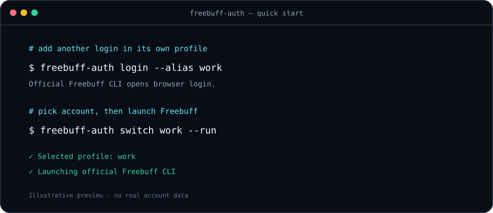

<div align="center">
  
  <h1>Freebuff Auth</h1>
  <p><strong>A fast Rust CLI that manages multiple Freebuff accounts and switches between them from the terminal.</strong></p>
  <p>Keep every login in its own profile. Pick one. Launch Freebuff with it.</p>
  <p>
    <a href="https://github.com/deactivated0/freebuff-auth/stargazers"></a>
    <a href="https://github.com/deactivated0/freebuff-auth/releases/latest"></a>
    <a href="https://github.com/deactivated0/freebuff-auth/blob/main/LICENSE"></a>
    
    
  </p>
</div>

<p align="center"></p>

> **Unofficial community project.** Not affiliated with or endorsed by Freebuff. The official Freebuff CLI handles login and account sessions.

<p align="center"></p>

## Contents

- [Why Freebuff Auth?](#why-freebuff-auth)
- [Install](#install)
  - [Prebuilt binaries](#prebuilt-binaries-recommended)
  - [From source with Cargo](#from-source-with-cargo)
  - [Nix and NixOS](#nix-and-nixos)
  - [NixOS installer ISO](#nixos-installer-iso)
- [Quick start](#quick-start)
- [Commands](#commands)
- [How profiles are kept separate](#how-profiles-are-kept-separate)
- [Configuration](#configuration)
- [FAQ](#faq)
- [Limitations](#limitations)
- [Contributing](#contributing)
- [License](#license)

## Why Freebuff Auth?

Freebuff Auth is a **multi-account manager for the Freebuff CLI**. Instead of swapping credential files by hand when you want to use a different Freebuff account, you register each login once and switch with a single command. The official Freebuff CLI stays responsible for authentication, so this tool never touches your tokens.

| | |
| --- | --- |
| **Separate profiles** | Every account lives in its own configuration directory. |
| **Fast switching** | Choose by number, email, alias, or account ID. |
| **One-step launch** | Start Freebuff with the selected account in one command. |
| **Token-conscious** | Never prints, copies, or rewrites bearer tokens. |
| **Honest output** | Shows no invented quota, plan, or reset information. |
| **Native and small** | Two Rust binaries, no runtime or framework. |

Works on **Linux, macOS, and Windows**, with static Linux builds and a Nix flake for reproducible installs.

## Install

**Requirements**

- The official Freebuff CLI, available as `freebuff` on your `PATH`. Install it separately using its current vendor instructions.
- To build from source: Rust 1.74 or newer, including Cargo.

### Prebuilt binaries (recommended)

Download the asset for your platform from the [latest release](https://github.com/deactivated0/freebuff-auth/releases/latest). Every archive holds both `freebuff-auth` and `freebuff-switch`, plus a matching `.sha256` checksum.

| Platform | Asset |
| --- | --- |
| **Windows x86_64** | `freebuff-auth-v*-x86_64-pc-windows-msvc.zip` |
| **Linux x86_64** | `freebuff-auth-v*-x86_64-unknown-linux-musl.tar.gz` (static, any distro) |
| **Linux arm64** | `freebuff-auth-v*-aarch64-unknown-linux-musl.tar.gz` (static, Raspberry Pi / ARM servers) |
| **macOS Apple Silicon** | `freebuff-auth-v*-aarch64-apple-darwin.tar.gz` |
| **macOS Intel** | `freebuff-auth-v*-x86_64-apple-darwin.tar.gz` |

**Linux and macOS**

```sh
sha256sum -c freebuff-auth-v0.2.0-x86_64-unknown-linux-musl.tar.gz.sha256
tar xzf freebuff-auth-v0.2.0-x86_64-unknown-linux-musl.tar.gz
install -m755 freebuff-auth-v0.2.0-x86_64-unknown-linux-musl/bin/* ~/.local/bin/
```

On macOS use `shasum -a 256 -c <file>.sha256` for the first step. Make sure `~/.local/bin` is on your `PATH`.

**Windows**

```powershell
Get-FileHash -Algorithm SHA256 .\freebuff-auth-v0.2.0-x86_64-pc-windows-msvc.zip
Expand-Archive .\freebuff-auth-v0.2.0-x86_64-pc-windows-msvc.zip -DestinationPath .
```

Then add the extracted `bin` folder to your `PATH`. The executables are `freebuff-auth.exe` and `freebuff-switch.exe`.

### From source with Cargo

```sh
git clone https://github.com/deactivated0/freebuff-auth.git
cd freebuff-auth
cargo install --path .
```

Cargo installs `freebuff-auth` and `freebuff-switch` into its binary directory, usually `~/.cargo/bin`. Add that directory to your `PATH` if needed.

You can also install the latest tagged release directly:

```sh
cargo install --git https://github.com/deactivated0/freebuff-auth --tag v0.2.0
```

### Nix and NixOS

This repository is a Nix flake. It packages both binaries, exports a NixOS module, and can build a live installer ISO.

```sh
nix run github:deactivated0/freebuff-auth                       # freebuff-auth
nix run github:deactivated0/freebuff-auth#freebuff-switch
nix profile install github:deactivated0/freebuff-auth
```

On an existing NixOS system, add the flake as an input and enable the module in your own `flake.nix`:

```nix
{
  inputs.freebuff-auth.url = "github:deactivated0/freebuff-auth";

  outputs = { nixpkgs, freebuff-auth, ... }: {
    nixosConfigurations.myhost = nixpkgs.lib.nixosSystem {
      system = "x86_64-linux";
      modules = [
        freebuff-auth.nixosModules.default
        {
          programs.freebuff-auth.enable = true;
          nixpkgs.overlays = [ freebuff-auth.overlays.default ];
        }
      ];
    };
  };
}
```

Then apply it:

```sh
sudo nixos-rebuild switch --flake /etc/nixos#myhost
```

This puts `freebuff-auth` and `freebuff-switch` on `PATH` system-wide. The official `freebuff` CLI is not packaged here; install it separately.

### NixOS installer ISO

The flake can build a bootable live ISO that installs a NixOS system with Freebuff Auth already enabled. Build it, write it to a USB stick, boot it, and install onto a disk:

```sh
nix build .#installer-iso
sudo dd if=result/iso/*.iso of=/dev/sdX bs=4M status=progress oflag=sync
```

On the booted ISO:

```sh
sudo freebuff-install /dev/nvme0n1   # ERASES that disk
```

The script creates a 1 GiB EFI partition at `/boot` and an ext4 root, copies this flake to `/etc/nixos`, and runs `nixos-install --flake /mnt/etc/nixos#freebuff`. It needs network access to fetch `nixpkgs`. The installed system boots with systemd-boot, enables flakes, and includes `freebuff-auth` and `freebuff-switch`.

The first account is `freebuff` with password `freebuff`; change it with `passwd`. Afterwards the system is managed with:

```sh
sudo nixos-rebuild switch --flake /etc/nixos#freebuff
```

## Quick start

**1. Register the account you already use**

```sh
freebuff-auth add --alias personal
```

**2. Sign in to a second account**

This opens the official Freebuff browser login inside a new isolated profile.

```sh
freebuff-auth login --alias work
```

**3. See what you have**

```sh
freebuff-auth list
```

**4. Switch and launch**

```sh
freebuff-auth switch work
freebuff-auth run
```

Or do both at once:

```sh
freebuff-auth switch work --run
```

Prefer a menu to typing commands? Run the interactive picker:

```sh
freebuff-switch            # pick an account
freebuff-switch --run      # pick an account and launch Freebuff
```

## Commands

Every command is available from `freebuff-auth`. `freebuff-switch` is the interactive picker for `switch` and `run`.

| Command | What it does |
| --- | --- |
| `list` | Show registered accounts and the selected profile |
| `login` | Sign in through the official Freebuff CLI in a new isolated profile |
| `add` | Register the existing default Freebuff profile |
| `import PATH` | Register an existing profile without copying credentials |
| `switch [QUERY]` | Select by number, alias, email, ID, or `-` for the previous account |
| `rotate` | Select the next profile in registration order; not quota-aware |
| `current` | Show the selected account |
| `alias set QUERY NAME` | Set an account nickname |
| `alias clear QUERY` | Remove an account nickname |
| `status` | Show registry and selected-profile health |
| `path` | Show configuration paths |
| `run -- ARGS...` | Launch the official Freebuff CLI and pass it arguments |
| `remove QUERY --yes` | Unregister an account without deleting its profile files |
| `usage` | Explain the usage-stat limitations |

Run `freebuff-auth --help` or `freebuff-auth COMMAND --help` for all options.

A Freebuff process that is already running keeps its current session. Restart it through `freebuff-auth run` to use a different account.

## How profiles are kept separate

Freebuff Auth sets `FREEBUFF_CONFIG_DIR` when it launches Freebuff. Each registered account gets its own config directory, so the official CLI manages credentials and the OS keychain entry for that profile, independently of the others.

Default paths:

```text
~/.config/manicode/credentials.json              existing Freebuff profile
~/.config/freebuff-auth/accounts.json            account metadata and profile paths
~/.config/freebuff-auth/profiles/<profile-id>/   isolated profiles
```

The registry stores metadata and paths, **not** bearer tokens. On Unix its directory is restricted to the current user. `remove` unregisters an account but leaves profile files and keychain entries intact.

## Configuration

| Variable | Purpose |
| --- | --- |
| `FREEBUFF_BIN` | Path to the official Freebuff executable |
| `FREEBUFF_CONFIG_DIR` | Existing/default profile directory to register |
| `FREEBUFF_AUTH_HOME` | Alternate Freebuff Auth data directory |
| `NO_COLOR=1` | Disable colored output |

## FAQ

**Can I use several Freebuff accounts on one machine?**
Yes. Each account lives in its own profile directory, and `freebuff-auth switch` decides which one `freebuff-auth run` launches.

**Does switching accounts log me out?**
No. Profiles are isolated, and each keeps its own session managed by the official Freebuff CLI. Switching only changes which profile is used next.

**Does Freebuff Auth store or read my tokens?**
No. It stores profile paths and metadata, and never prints, copies, or rewrites bearer tokens. Login and OAuth remain with the official CLI.

**Why does it not show quota or plan usage?**
There is no verified, supported usage API for this tool to rely on, so it reports nothing rather than guessing.

**Does it work on Windows, macOS, and Linux?**
Yes. Prebuilt Windows, macOS, and static Linux binaries are published on every release, and the Nix flake covers Linux and NixOS.

## Limitations

- Login and OAuth are handled by the official Freebuff CLI.
- Tokens are not extracted, migrated, or rewritten.
- Quotas and plan limits are not shown, because no verified supported usage API is available here.
- Switching does not change an already-running Freebuff process.

## Contributing

Issues and pull requests are welcome. Never include real credentials, account exports, tokens, or private profile data in issues, screenshots, or test fixtures.

## License

MIT. See [LICENSE](LICENSE).
