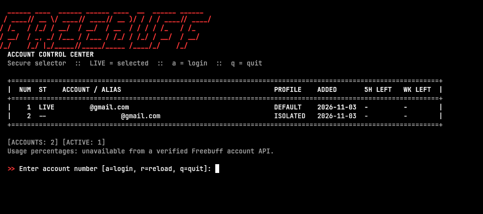
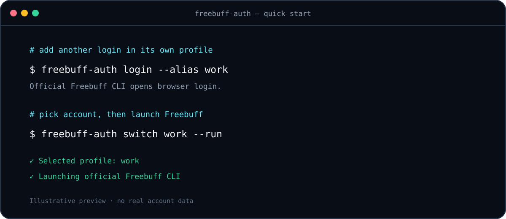

<div align="center">
  
  <h1>Freebuff Auth</h1>
  <p><strong>Manage multiple Freebuff CLI accounts with a fast, Rust-powered terminal switcher.</strong></p>
  <p>Keep profiles separate. Pick one. Launch Freebuff with it.</p>
  <p>
    <a href="https://github.com/deactivated0/freebuff-auth/stargazers"></a>
    <a href="https://github.com/deactivated0/freebuff-auth/blob/main/LICENSE"></a>
    
  </p>
</div>

<p align="center"></p>

> **Unofficial community project.** Not affiliated with or endorsed by Freebuff. The official Freebuff CLI handles login and account sessions.

<p align="center"></p>

## Why Freebuff Auth?

Manage multiple Freebuff CLI logins without manually swapping credential files. Each account gets a separate profile directory, while the official Freebuff CLI remains responsible for authentication.

- **Separate profiles:** keep each account's configuration in its own directory.
- **Fast switching:** choose by number, email, alias, or account ID.
- **Launch in one step:** start Freebuff using the selected profile.
- **Token-conscious:** never prints, copies, or rewrites bearer tokens.
- **Honest usage data:** does not invent quota, plan, or reset information.
- **Rust-powered:** small native command-line tools, no runtime framework.

## Install

### Requirements

- Rust 1.74 or newer, including Cargo.
- The official Freebuff CLI available as `freebuff` on your `PATH`.

Install the official Freebuff CLI separately, using its current vendor instructions.

### Build and install

```sh
git clone https://github.com/deactivated0/freebuff-auth.git
cd freebuff-auth
cargo install --path .
```

Cargo installs `freebuff-auth` and `freebuff-switch` into its binary directory, usually `~/.cargo/bin`. Add that directory to your `PATH` if needed.

## Quick start

```sh
# Register the existing default Freebuff login
freebuff-auth add --alias personal

# Sign in to another account with the official Freebuff browser login
freebuff-auth login --alias work

# List accounts and choose one
freebuff-auth list
freebuff-auth switch work

# Launch Freebuff with the selected profile
freebuff-auth run
```

Open the interactive account picker any time:

```sh
freebuff-switch
```

Switch and launch together:

```sh
freebuff-auth switch work --run
freebuff-switch --run
```

`switch` selects the profile used by `freebuff-auth run`. A Freebuff process already running elsewhere keeps its current session; restart it through `freebuff-auth run` to use another account.

## Commands

| Command | Description |
| --- | --- |
| `list` | Show registered accounts and the selected profile |
| `login` | Sign in through official Freebuff CLI in a new isolated profile |
| `add` | Register the existing default Freebuff profile |
| `import PATH` | Register an existing profile without copying credentials |
| `switch [QUERY]` | Select by number, alias, email, ID, or `-` for previous |
| `rotate` | Select next profile in registration order; not quota-aware |
| `current` | Show selected account |
| `alias set QUERY NAME` | Set an account nickname |
| `alias clear QUERY` | Remove an account nickname |
| `status` | Show registry and selected profile health |
| `path` | Show configuration paths |
| `run -- ARGS...` | Launch official Freebuff and pass it arguments |
| `remove QUERY --yes` | Unregister account without deleting profile files |
| `usage` | Explain usage-stat limitations |

Run `freebuff-auth --help` or `freebuff-auth COMMAND --help` for all options.

## Profile isolation and privacy

Freebuff Auth sets `FREEBUFF_CONFIG_DIR` when it launches Freebuff. Each registered account uses a separate config directory, so the official CLI can manage its own credentials and OS keychain entry for that profile.

Default paths:

```text
~/.config/manicode/credentials.json              existing Freebuff profile
~/.config/freebuff-auth/accounts.json             account metadata and profile paths
~/.config/freebuff-auth/profiles/<profile-id>/    isolated profiles
```

The account registry stores metadata and paths, not bearer tokens. On Unix, its directory is restricted to the current user. `remove` unregisters an account but leaves profile files and keychain entries intact.

Configuration variables:

- `FREEBUFF_BIN`: path to official Freebuff executable.
- `FREEBUFF_CONFIG_DIR`: existing/default profile directory to register.
- `FREEBUFF_AUTH_HOME`: alternate Freebuff Auth data directory.
- `NO_COLOR=1`: disable colored output.

## Scope and limitations

- Login and OAuth are handled by the official Freebuff CLI.
- Tokens are not extracted, migrated, or rewritten.
- Quotas and plan limits are not shown because no verified supported usage API is available here.
- Switching does not change an already-running Freebuff process.

## Contributing

Issues and pull requests are welcome. Never include real credentials, account exports, tokens, or private profile data in issues, screenshots, or test fixtures.

## License

MIT. See [LICENSE](LICENSE).
